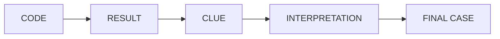
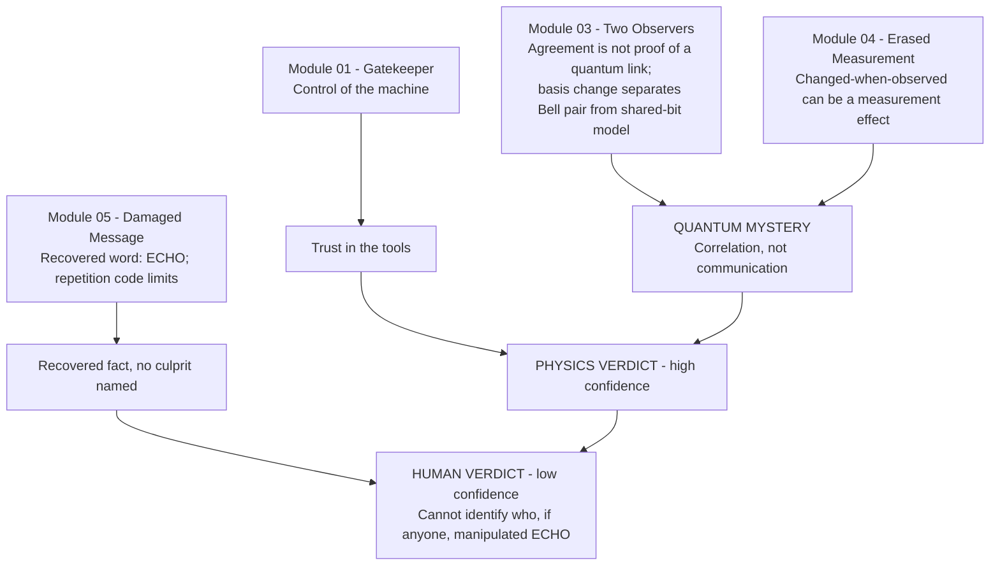
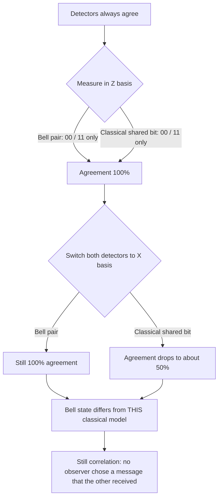

# ECHO — The Signal That Was Never Sent

**Entangled Minds — The Quantathon** · Qubits Qrew, NED University of Engineering & Technology
**Participant:** Muhammad Feras Malik · **GitHub:** [Supl3x](https://github.com/Supl3x) · **Format:** individual submission
**Selected stretch module:** Module 04 — The Erased Measurement
**Simulator:** Qiskit Aer (ideal, no noise) · **Environment:** Google Colab

> **One-line verdict.** ECHO did **not** demonstrate faster-than-light communication: two detectors that always agree show *correlation*, and a simple pre-agreed classical model reproduces that agreement. The evidence says much less about *who* (if anyone) manipulated the experiment, and I do not accuse anyone.

---

## Table of contents
1. [Repository contents](#1-repository-contents)
2. [How to run](#2-how-to-run)
3. [The investigation at a glance](#3-the-investigation-at-a-glance)
4. [Module 01 — The Gatekeeper](#4-module-01--the-gatekeeper-mandatory)
5. [Module 03 — The Two Observers](#5-module-03--the-two-observers-mandatory)
6. [Module 05 — The Damaged Message](#6-module-05--the-damaged-message-mandatory)
7. [Module 04 — The Erased Measurement (stretch)](#7-module-04--the-erased-measurement-selected-stretch)
8. [Evidence board](#8-evidence-board)
9. [Final theory and confidence](#9-final-theory-and-confidence)
10. [Alternative theory](#10-alternative-theory)
11. [Proposed next experiment](#11-proposed-next-experiment-module-06)
12. [Statistical sanity check](#12-statistical-sanity-check-of-the-reported-counts)
13. [Limitations](#13-limitations)
14. [References](#14-references)
15. [AI / external assistance disclosure](#15-ai--external-assistance-disclosure)

---

## 1. Repository contents

| File | Description |
|---|---|
| `ECHO_Quantathon_Colab_Final.ipynb` | Final executed notebook (Modules 01, 03, 05 + stretch Module 04) with saved outputs |
| `ECHO_Case_Report_Final.pdf` | Written case report (3 pages + 1 supplementary page of circuit diagrams) |
| `images/` | Histogram panel and circuit diagrams used in this README (taken from the executed notebook outputs) |
| `README.md` | This document |

> If your notebook file has a different name, edit the table above.

## 2. How to run

1. Open the notebook in Google Colab (or Jupyter) and choose **Runtime → Run all**.
2. The first cell installs dependencies: `pip install qiskit qiskit-aer pylatexenc matplotlib numpy`.
3. All circuits run on `AerSimulator()` through a small helper `run_circuit(circuit, shots)`.

**Reproducibility note.** Neither the Aer runs nor the NumPy classical sampler use a fixed seed. The numbers in this README are copied from the saved outputs of one executed run. Re-running gives statistically similar but not identical counts for the random experiments (for example `1020/980` may become `1003/997`). Deterministic results (`{'1': 1000}`, `{'0': 1000}`, `{'101': 1000}`, and 0 mismatches for the Bell pair) never change.

---

## 3. The investigation at a glance

The competition frames each module as a clue, not an isolated exercise:



How each module feeds the case:



---

## 4. Module 01 — The Gatekeeper (mandatory)

**Purpose.** Show control of the quantum machine with H, X and measurement. This module sets up trust in the tools; it is *not* a clue about the suspects.

| Level | Circuit | Prediction | Result (executed notebook) |
|---|---|---|---|
| Bronze A | X on \|0⟩, measure | always `1` | `{'1': 1000}` |
| Bronze B | H on \|0⟩, measure (2000 shots) | ≈ 50/50 | `{'0': 1020, '1': 980}` → P(0)=0.51, P(1)=0.49 |
| Silver | H → H, measure | always `0` (H² = I) | `{'0': 1000}` |
| Gold | X on qubit 0 and qubit 2 of \|000⟩ | `101` | `{'101': 1000}` |

<p>


</p>

**Analysis.**
- $X|0\rangle = |1\rangle$, so the outcome is deterministic.
- $H|0\rangle = \frac{|0\rangle+|1\rangle}{\sqrt2}$, so each outcome has probability ½. The observed 1020/980 split is an ordinary statistical fluctuation (see [§12](#12-statistical-sanity-check-of-the-reported-counts)).
- $H^2 = I$, so the second Hadamard undoes the first: the state looks "uncertain in the middle" but ends certain.
- Qiskit prints bitstrings with qubit 0 on the right, so applying X to qubits 0 and 2 gives `101`.

**What this proves:** the machine reliably prepares deterministic states, superposition, and the required 3-bit pattern.

---

## 5. Module 03 — The Two Observers (mandatory; the crux of the case)

**The question.** Zara's two detectors always agreed. Does that prove a quantum link, or something simpler?

### 5.1 Bronze — build the Bell pair

```python
bell_z = QuantumCircuit(2, 2)
bell_z.h(0)
bell_z.cx(0, 1)
bell_z.measure([0, 1], [0, 1])
```

$$|00\rangle \xrightarrow{H\otimes I} \frac{|00\rangle+|10\rangle}{\sqrt2} \xrightarrow{\text{CNOT}_{0\to1}} \frac{|00\rangle+|11\rangle}{\sqrt2}$$


**Result (4000 shots):** `{'11': 2004, '00': 1996}` — agreement **100.0 %**, mismatch **0.0 %**. No `01` or `10` ever appeared.

### 5.2 Silver — a classical model can imitate it

Two classical observers agree beforehand on a random bit and both output it (`00` if the bit is 0, `11` if it is 1).

**Result (4000 samples):** `{'00': 1997, '11': 2003}`.

In the computational basis this is statistically indistinguishable from the Bell pair. So **same-basis agreement alone cannot tell an entangled pair from a pre-agreed secret.**

### 5.3 Gold — change the measurement basis

Apply H to both qubits just before measuring (this is a measurement in the X basis).

```python
bell_x = QuantumCircuit(2, 2)
bell_x.h(0); bell_x.cx(0, 1)
bell_x.h(0); bell_x.h(1)           # change of basis
bell_x.measure([0, 1], [0, 1])
```


**Why the two models behave differently — the algebra.**

For the Bell state:

$$(H\otimes H)\frac{|00\rangle+|11\rangle}{\sqrt2}=\frac{1}{2\sqrt2}\Big[(|0\rangle+|1\rangle)(|0\rangle+|1\rangle)+(|0\rangle-|1\rangle)(|0\rangle-|1\rangle)\Big]=\frac{|00\rangle+|11\rangle}{\sqrt2}$$

The cross terms cancel, so only `00` and `11` survive: **perfect agreement is preserved**.

For the classical shared-bit model (a mixture of $|00\rangle$ and $|11\rangle$):

$$(H\otimes H)|00\rangle=\tfrac12(|00\rangle+|01\rangle+|10\rangle+|11\rangle),\qquad (H\otimes H)|11\rangle=\tfrac12(|00\rangle-|01\rangle-|10\rangle+|11\rangle)$$

Each case gives all four outcomes with probability ¼, so the mixture agrees only **50 %** of the time.

**Results.**

| Model | Counts | Agreement |
|---|---|---|
| Bell pair, X basis (4000 shots) | `{'00': 1940, '11': 2060}` | **100.0 %** |
| Classical `00/11` mixture, X basis | `{'11': 492, '01': 519, '00': 501, '10': 487}` | **49.67 %** |

*How the classical counts were produced:* \|00⟩ and \|11⟩ were each run for 2000 shots, each count was integer-halved (`v // 2`) and the two were summed. The total is therefore 1999 (not 2000), and agreement is (501 + 492) / 1999 = 49.67 %.


*Figure: histograms redrawn from the exact counts printed in the executed notebook.*



### 5.4 Interpretation and exact scope of the claim

- **Safe claim:** the basis-change test distinguishes the Bell state from the *specific* pre-agreed shared-bit model used in the challenge.
- **Not claimed:** this is *not* a loophole-free Bell test and does *not* rule out every classical hidden-variable theory. A classical strategy pre-agreed for the X basis would also reproduce a single-basis X result; only tests with randomly varying measurement bases (for example a CHSH-type test) could address broader classical models.
- **Even the quantum result is still only correlation.** Nothing in these experiments has one observer choose an input that changes the other's outcomes.

**What this proves:** same-basis detector agreement alone cannot distinguish an entangled Bell pair from a simple pre-agreed classical correlation. *(One of the strongest clues in the case.)*

---

## 6. Module 05 — The Damaged Message (mandatory)

**Setup.** A 96-bit stream arranged as 32 triples; each original bit was sent three times with at most one flip per triple.

```text
100 011 001 001 001 011 100 110
001 011 000 000 001 100 011 011
000 111 000 000 110 000 001 000
000 111 001 010 101 011 111 111
```

### 6.1 Bronze — majority-vote decoding

```python
def majority_vote(triple):
    return "1" if triple.count("1") > triple.count("0") else "0"
```

| Step | Output |
|---|---|
| Recovered 32 bits | `01000101010000110100100001001111` |
| 8-bit groups | `01000101` `01000011` `01001000` `01001111` |
| ASCII | E, C, H, O |
| **Recovered word** | **ECHO** |

### 6.2 Silver — where it breaks

| Encoded bit | Corruption | Received | Majority result |
|---|---|---|---|
| `111` (bit = 1) | none | `111` | 1 ✅ |
| `111` | one flip | `101` | 1 ✅ |
| `111` | two flips | `001` | **0 ❌** |

Majority voting fails exactly when two bits of the same triple flip.

### 6.3 Gold — capability and the no-cloning theorem

- Valid codewords are `000` and `111`, at **Hamming distance 3**.
- Distance 3 lets the code **correct 1** flip per triple (or **detect up to 2** without correcting). Two flips move a codeword closer to the *wrong* codeword, which is why majority voting returns the wrong bit.
- **A qubit cannot be protected by simply copying it three times.** An arbitrary unknown quantum state cannot be cloned (no-cloning theorem, Wootters & Zurek 1982). Real quantum error correction uses entanglement and syndrome measurements instead. This module does **not** demonstrate a quantum error-correcting code.

**What this proves:** majority voting recovered the damaged message as ECHO and reliably corrects one bit flip per triple, while two flips in the same triple can defeat the decoder.

---

## 7. Module 04 — The Erased Measurement (selected stretch)

**The question.** A log entry "changed when it was observed." Is that physics, or a cover story? This module compares reversible evolution with evolution interrupted by measurement.

### 7.1 Bronze A — a recoverable sequence (H → H)


Result: `{'0': 1000}`. Because $H^2=I$, the original state returns.

### 7.2 Bronze B — insert a measurement


Sequence: H → measure → H → measure (4000 shots). In Qiskit's key order the first character is the **second** measurement and the second character is the **first** measurement.

| Joint outcome (second, first) | Count | Share |
|---|---|---|
| `00` | 974 | 24.35 % |
| `01` | 1001 | 25.03 % |
| `10` | 1076 | 26.90 % |
| `11` | 949 | 23.73 % |

**Analysis.**
1. After the first H the qubit is in an equal superposition. The first measurement gives 0 or 1 with probability ½ and **collapses** the state to $|0\rangle$ or $|1\rangle$.
2. The second H acts on that now-definite state: $H|0\rangle$ and $H|1\rangle$ each give a 50/50 outcome.
3. The second result is therefore independent of the first, giving four joint outcomes of probability ¼ each.
4. Contrast with Bronze A, where the same two H gates give a *certain* `0`. The only difference is the measurement, so **the measurement, not the gates, did the erasing**: it replaced a coherent superposition by a classical outcome.

### 7.3 Silver — predict first, then run

| Sequence | Reasoning | Prediction | Result |
|---|---|---|---|
| X → H → H | $H^2=I$, so the circuit equals X | `1` | `{'1': 1000}` ✅ |
| H → X → H | $HXH = Z$ and $Z\lvert 0\rangle=\lvert 0\rangle$ | `0` | `{'0': 1000}` ✅ |

<p>


</p>

The sequence H → X → H is the operator product $HXH$, which equals $Z$ (it reads the same in either time order), and $Z|0\rangle=|0\rangle$.

### 7.3b Quick state-tracking rules for new sequences
- X flips $|0\rangle \leftrightarrow |1\rangle$.
- H sends $|0\rangle \to |+\rangle$ and $|1\rangle \to |-\rangle$ (and back).
- Measuring $|+\rangle$ or $|-\rangle$ in the Z basis is 50/50; a measurement mid-circuit makes everything after it start from a definite $|0\rangle$ or $|1\rangle$.
- Identities: $HH=I$, $XX=I$, $HXH=Z$, $HZH=X$.

### 7.4 Gold preparation / judge prediction practice

> This section is **practice only**. It does not complete the live Gold task, where a judge gives a *new* sequence to predict before it is run.

A helper `test_sequence(seq)` builds and runs any H/X sequence. Practice results:

| Sequence | Result |
|---|---|
| H → H | `{'0': 1000}` |
| X → X | `{'0': 1000}` |
| X → H → H | `{'1': 1000}` |
| H → X → H | `{'0': 1000}` |
| H | `{'0': 507, '1': 493}` |
| X | `{'1': 1000}` |

**What this proves:** H and X operations can be reversible, while measurement produces a classical outcome and removes the coherence needed to reverse the earlier evolution in the same way.

> **Scope note.** Module 04 shows that a changed result after observation *can* be a measurement effect. It does **not** prove that any suspect is innocent or guilty.

---

## 8. Evidence board

| Type | Entries |
|---|---|
| **FACT** (directly observed) | M01: X → `{'1': 1000}`; H → 1020/980; H→H → `0`; `101` prepared. M03: Bell pair Z-basis only `00`/`11` (agreement 100 %); classical shared-bit model also only `00`/`11`; X-basis agreement 100 % (Bell) vs 49.67 % (classical). M05: stream decodes to **ECHO**. M04: H→H → `0`; X→H→H → `1`; H→X→H → `0`; measurement inserted → all four joint outcomes appear. |
| **CLAIM** (stated by characters; not established) | **Zara:** ECHO sends information faster than light via entanglement. **Prof. Imran Vance:** "ECHO was never real." **Sana Rao:** "I only deleted a corrupted log." **Bilal Noor:** "I warned her. Nobody listened." **ARIA:** "No unauthorised command was issued." |
| **INFERENCE** (my interpretation) | Same-basis agreement alone is insufficient evidence for a communication claim. Some post-observation changes can be explained by measurement effects. Over-interpretation of the physics is a plausible explanation for Zara's claim. |
| **OPEN QUESTION** | Who configured ARIA's final experiment schedule? What was in Bilal's missing report? Why did Sana delete the log and what did it contain? Was ECHO deliberately manipulated? What happened to Zara? |

**The three clues that shaped my theory**
1. **Module 03 Silver** — agreement is cheap: a classical shared bit gives the same 00/11 pattern as the Bell pair.
2. **Module 03 Gold** — changing basis separates the Bell state from that classical model (100 % vs 49.67 %), yet it is still correlation, not a message.
3. **Module 04** — "changed when observed" is not automatically "hacked"; measurement alone can change later outcomes.

---

## 9. Final theory and confidence

**Physics verdict — high confidence.** ECHO did not demonstrate faster-than-light communication. Detector correlation alone is not equivalent to controllable communication. Same-basis agreement can be reproduced by a simple classical shared-bit model, so agreement by itself is not sufficient evidence for the stronger communication claim. The "no signalling" conclusion rests on two things: these experiments, and the standard no-signalling property of quantum mechanics, which this notebook does not itself test (Module 06 would test an instance of it).

**Human verdict — low confidence.** The available evidence does not establish whether Zara made an honest interpretive mistake, whether someone encouraged that interpretation, or whether the experiment was deliberately manipulated. **No suspect is accused.**

**Who or what was responsible?** The best-supported explanation is a *reasoning error in the physics* — same-basis correlation treated as stronger evidence than it is. The evidence does not identify any person as responsible for the events at the lab.

---

## 10. Alternative theory

**Deliberate manipulation or sabotage** is the strongest competing theory. It remains plausible because:
- Vance had technical knowledge and a stated motive to see ECHO fail.
- Sana had privileged log access and admits deleting a log.
- Bilal reported a discrepancy before the final run, and his report is missing.
- ARIA ran the schedule. Its statement that no *unauthorised* command was issued does not answer who configured the *authorised* instructions beforehand.

These are leads, not proof; **nothing here identifies a saboteur.** I prefer the physics-over-interpretation theory because the completed experiments already reveal a concrete reasoning gap sufficient to undermine the communication claim, while sabotage is possible but not required by the evidence.

---

## 11. Proposed next experiment (Module 06)

*This is a proposal only. Module 06 was not my selected stretch module.*

Run the official teleportation circuit from the hint notebook **(1) with** and **(2) without** the required classical corrections.

| Hypothesis | Expected result |
|---|---|
| **Physics over-interpretation** (my theory) | With corrections, the receiver recovers the intended state (near-perfect in ideal simulation). Without them, the receiver's outcomes look random and independent of the sent state, so entanglement alone carries no usable message. |
| **Sabotage** (alternative) | Module 06 tests the physics, not the people; a correct circuit gives the same result under either hypothesis. Distinguishing sabotage would need non-quantum evidence, such as ARIA's schedule-configuration history or the missing report, if obtainable. |

---

## 12. Statistical sanity check of the reported counts

A chi-square goodness-of-fit test of each result against its ideal-simulator prediction (equal probabilities). These are checks on a single run, not proofs.

| Result | Expected | χ² | p-value | Comment |
|---|---|---|---|---|
| H on \|0⟩: 1020 / 980 | 50/50 | 0.80 | 0.37 | consistent |
| H alone (practice): 507 / 493 | 50/50 | 0.20 | 0.66 | consistent |
| Bell Z: 1996 / 2004 | 50/50 | 0.02 | 0.90 | consistent |
| Classical Z: 1997 / 2003 | 50/50 | 0.01 | 0.92 | consistent |
| Bell X: 1940 / 2060 | 50/50 | 3.60 | 0.058 | borderline-consistent |
| Classical X: 501/519/487/492 | uniform | 1.19 | 0.76 | consistent |
| M04 Bronze B: 974/1001/1076/949 | uniform | 9.05 | 0.029 | mildly unusual for one run |

The Module 04 Bronze B result is the one outlier: p ≈ 0.03 means roughly 3 in 100 ideal runs would deviate this much by chance. This is not evidence of a physics problem — the ideal prediction is exactly ¼ each, and an unseeded re-run will usually land closer to 1000 per outcome. I report the saved run as it was and do not replace it with cleaner numbers.

---

## 13. Limitations

1. All experiments used the Qiskit Aer **ideal simulator**, not real hardware. Real devices add noise, decoherence and imperfect gates.
2. The Module 03 Gold test distinguishes the Bell state only from the **specific** pre-agreed shared-bit model. It is not a loophole-free Bell experiment and does not disprove every classical hidden-variable theory.
3. Counts come from a single unseeded run (see [§2](#2-how-to-run)); the classical X-basis counts total 1999 due to integer halving.
4. The modules test the physics but **do not solve the human forensic mystery**. The evidence cannot identify who, if anyone, intentionally manipulated ECHO.
5. The recovered word ECHO is not treated as proof of any additional hidden statement beyond what the official materials provide.
6. Module 05 demonstrates a classical repetition code only — not full quantum error correction.

---

## 14. References

- Qubits Qrew, NED University. *ECHO — The Signal That Was Never Sent: Participant Manual.* Entangled Minds: The Quantathon, 2026.
- Qubits Qrew, NED University. *ECHO Investigation / Hint Notebook.* Entangled Minds: The Quantathon, 2026.
- Qubits Qrew, NED University. *Code of Conduct — Entangled Minds: The Quantathon,* 2026.
- IBM Quantum. Qiskit and Qiskit Aer documentation.
- Wootters, W. K. & Zurek, W. H. (1982). A single quantum cannot be cloned. *Nature*, 299, 802–803.
- Nielsen, M. A. & Chuang, I. L. (2010). *Quantum Computation and Quantum Information* (10th anniversary ed.). Cambridge University Press.

---

## 15. AI / external assistance disclosure

AI tools were used for code scaffolding, Qiskit syntax assistance, debugging, conceptual explanation, project organization, consistency checking, and documentation drafting. The numerical results reported were generated by executing the submitted Qiskit notebook. AI-generated text or suggestions were not treated as experimental evidence. The participant remains responsible for reviewing, understanding, explaining, and defending the final work.
